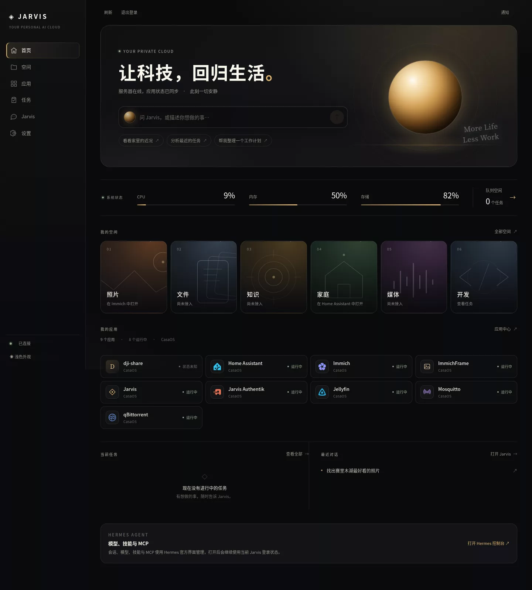
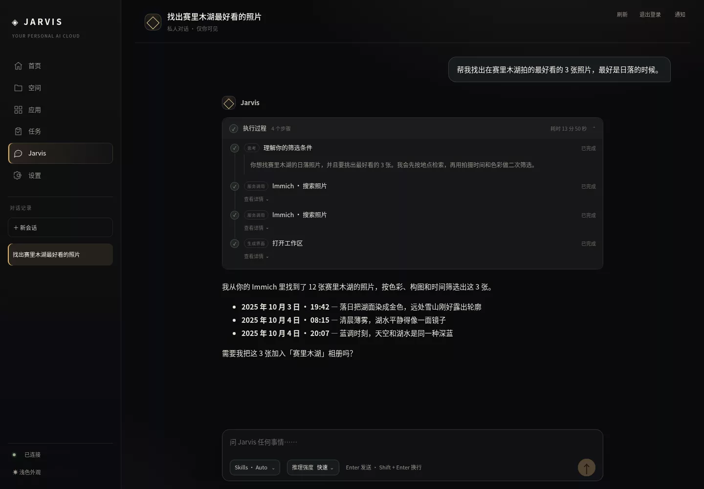
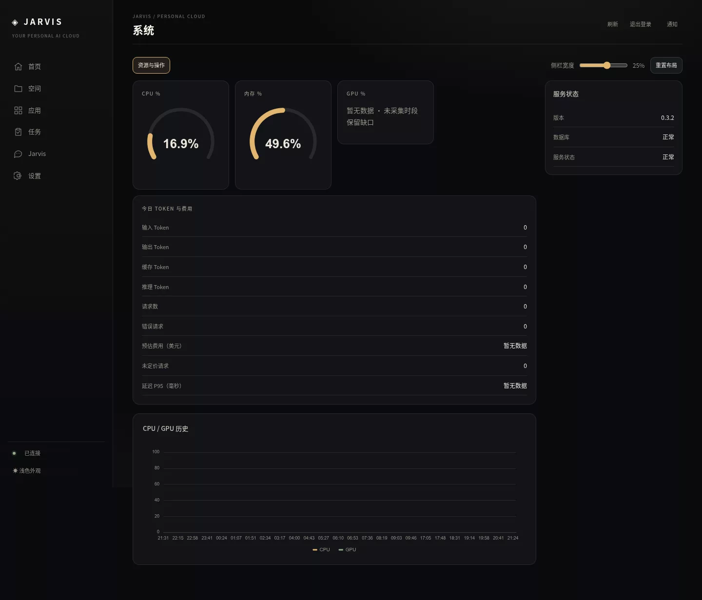
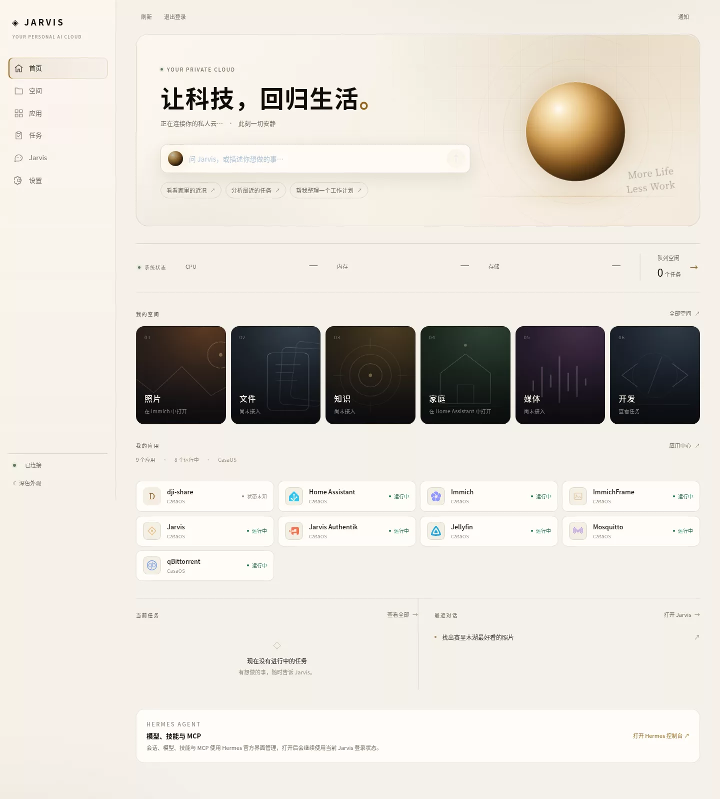
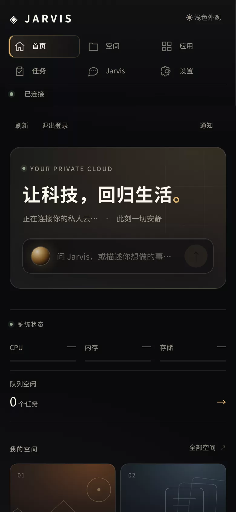
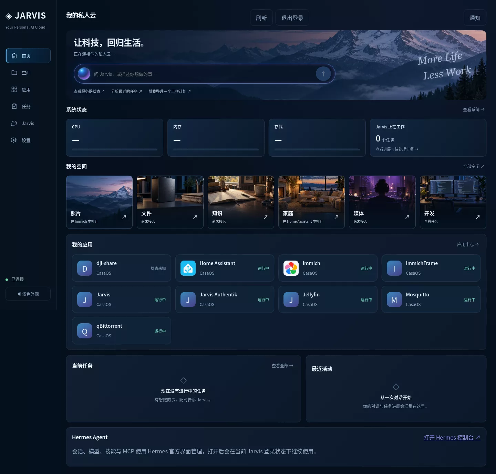
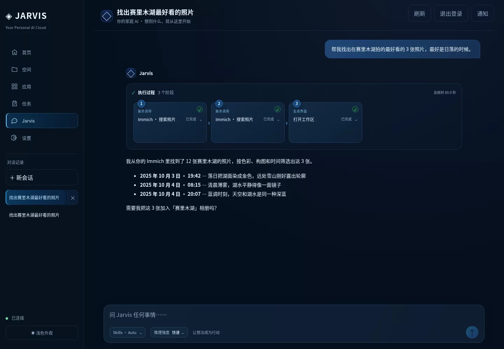

# Jarvis 视觉方向 v2 · Lantern

> 分支：`design/visual-refresh`  
> 目标：把 Jarvis 从「蓝色科技仪表盘」改成安静、温暖、可信的私人云入口，并让对话体验接近 Codex / Claude Code 的信息密度与完成度。

## 为什么改

旧界面能完成任务，但有几处让人出戏：

- **像通用 SaaS 模板**：深蓝底 + 青色高亮、满屏卡片、顶部大号英文 eyebrow，和「家」没有关系。
- **空间封面与内容无关**：文件空间是一对音箱，知识空间是一本书，照片空间是雪山；它们只是装饰，而且彼此风格不统一。
- **对话页执行过程太占空间**：每次工具调用都是大号横排卡片，内容很少、留白很多；长任务会横向滚动。
- **浅色主题像补丁**：侧栏、卡片、选中态里残留蓝紫色，和暖色背景冲突。
- **原生表单控件没有统一**：`select` 在深色下出现棕色底，日期输入是浏览器默认蓝色。

## 新方向：Lantern

把 Jarvis 想象成家里的一盏灯：不刺眼，但一直在。

| 维度 | 旧 | 新 |
| --- | --- | --- |
| 主色 | 深蓝 + 青色 | 墨黑 / 暖象牙 / 琥珀金 |
| 辅助色 | 紫蓝渐变 | 鼠尾草绿（在线、成功） |
| 字体 | Inter 单字体 | 无衬线正文 + 衬线英文签名（More Life / Less Work） |
| 表面 | 大量同质卡片 | 发丝线、留白、少量真正需要边界的表面 |
| 图形 | 无关 stock 照片 | 六套统一的线性空间图形 + 真实应用 glyph |
| 对话 | 横向大卡片 | 可折叠执行摘要 + 纵向时间线 + 默认展开推理 |

> 这只是第一版方向。如果更喜欢冷色、极简黑白或更「工具化」的 Codex 风格，可以在同一套 token 上快速切换。

## 改了什么

### 首页

- 首屏改成有呼吸感的「灯」场景：暖色轨道、光晕、颗粒、细网格；不再使用雪山 stock 图。
- 命令栏变成半透明浮层，聚焦时有琥珀色光边。
- 三个大指标卡 + 任务卡合并成一条系统状态带：CPU / 内存 / 存储 / 队列。
- 「我的空间」改为六张统一线稿卡：山与月、纸张、同心圆、房子、声波、代码括号。
- 应用列表使用真实 glyph（Home Assistant / Immich / Jellyfin / qBittorrent / Mosquitto / Authentik 等），统一放在中性 icon well 里。
- 任务与最近对话降级为两列发丝线列表，不再抢首屏。



### 对话

这是这次改动的重点。

- 历史会话的执行过程默认折叠成一行：`✓ 执行过程 · 4 个步骤 · 耗时 13 分 50 秒`，点开才是纵向时间线。
- 每一步只有：状态点、类型、标题、状态；推理内容直接展开，工具输出按需展开。
- 实时任务自动展开，结束后保持展开，方便回看推理；历史会话默认折叠，可手动收起。开发者模式仍可查看原始数据。
- 用户消息变成右对齐的小气泡，助手回复是无边框的正文，阅读宽度收窄到 780px。
- 输入框变成悬浮的底部命令面板，Skills、推理强度、快捷键提示在同一行。
- 空状态提供三个可点击的真实任务建议，点击后填入输入框而不是直接发送。



### 系统 / 设置 / 任务

- 仪表盘改为细琥珀弧线；服务状态、Token 统计不再换行。
- 修复 CPU/GPU 图表图例与时间轴重叠的问题，图例移到图表下方。
- 设置页去掉重复的「设置」大标题，统一表单控件和日期选择器。
- 任务页的筛选、搜索、定时任务表单统一成同一套控件。



### 浅色与移动端

- 浅色主题改为暖纸色，不是简单的「深色反转」；侧栏、选中态、输入框全部重新配过。
- 移动端导航改成 3 列网格，不再横向裁切；应用卡片在窄屏只保留状态圆点，给名称让位。
- 对话页在移动端变成上下结构，输入框和线程都可用。





## 对比

| 旧 | 新 |
| --- | --- |
|  |  |
|  |  |

## 如何预览

```bash
# 依赖已安装的情况下
npm run dev:web
# 打开 http://127.0.0.1:5173
```

开发服务器会把 `/api` 和 `/ws` 代理到 `127.0.0.1:8080`，并自动修正 API 的 Origin 校验，因此可以直接用本地账号登录。

生产构建预览：

```bash
npm run build:web
npx vite preview apps/web --port 4173
```

> 没有自动部署到运行中的 Jarvis 容器；线上仍是旧版本，确认方向后再部署。

## 代码结构

- `apps/web/src/design.css`：新的设计 token、外壳、首页、空间、应用、任务、系统、设置、浅色/响应式覆盖层。
- `apps/web/src/product.tsx`：首页结构、六套空间线稿、应用 glyph 映射。
- `apps/web/src/jarvis-conversation.tsx`：可折叠执行时间线、欢迎建议、新的执行流组件。
- `apps/web/src/conversation.css`：新版执行时间线、消息列宽、输入面板、移动端。
- `apps/web/src/chart.tsx`：琥珀 / 鼠尾草图表、图例与坐标轴修复。
- `apps/web/public/app-icons/glyphs/`：单色品牌 glyph。
- `apps/web/vite.config.ts`：开发/预览代理的 Origin 修正。

## 下一步可以讨论

1. **方向确认**：暖琥珀 vs 冷青 vs 中性黑白，你更偏向哪一个？
2. **强度**：首页的「灯」是否可以更克制（更小、更暗）？
3. **信息密度**：对话页是否要把工具调用默认展开，还是保持 Codex 式折叠？
4. **空间**：六张线稿是否够，还是希望每张空间有自己的真实内容摘要？
5. **部署**：确认后我可以把 Web 产物更新到 CasaOS 上的 Jarvis 容器。
